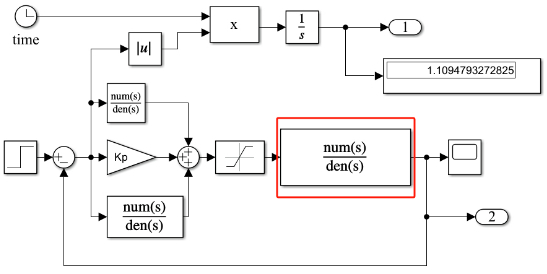

# Particle Swarm Optimization and Genetic Algorithm Tuning of PID Parameters, with the ability to freely modify the transfer function, free MATLAB code.

Code acquisition method: click the link to redirect.
Particle swarm and genetic algorithms tune PID parameters, transfer function can be freely modified, free MATLAB code obtained.

## Images

<!-- PAYMENT_BLOCK -->

## Get this dataset

- Payment link (Stripe): [Buy now](https://buy.stripe.com/3cs8yP7sY87d0vu9AB)
- Payment QR code: 

<!-- /PAYMENT_BLOCK -->
